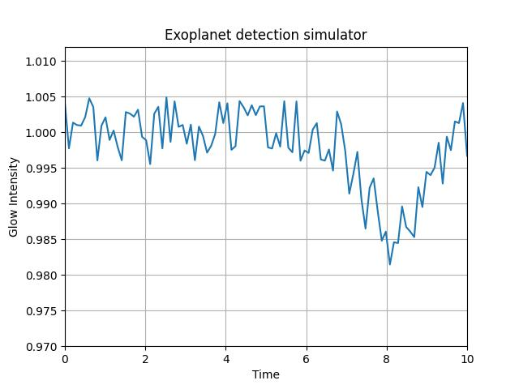

# 🔭 Exoplanet Detection Simulator

A simple Python simulator that generates a synthetic **light curve** (stellar brightness over time) and randomly decides whether a planet is transiting the star. It has a **10% chance of "detecting" an exoplanet** on each run.

## How it works

The simulator uses the **transit method**, one of the main techniques astronomers use to find exoplanets: when a planet passes in front of its star, the star's brightness drops slightly.

1. A star's brightness is simulated at 100 points over 10 time units, with random noise.
2. With a 10% probability, a transit is added: a dip of about 1.5% in brightness lasting about 3 time units, starting at a random moment.
3. With a 90% probability, only noise is generated (no planet).
4. The resulting light curve is plotted and saved as `grf.jpg`.

| Outcome | Probability | Noise | Light curve |
|---|---|---|---|
| Exoplanet detected | 10% | ±0.5% | Dip in brightness |
| No exoplanet | 90% | ±1% | Flat, noisy line |

## Requirements

- Python 3.8+
- [NumPy](https://numpy.org/)
- [Matplotlib](https://matplotlib.org/)

```bash
pip install numpy matplotlib
```

## Usage

```bash
python main.py
```

Each run produces a new random light curve and saves it as `grf.jpg`. Run it several times to see both outcomes.

## Example output

**Exoplanet detected** (brightness dips during the transit):



> Note: since results are random, your graph will look different every time.

## Project structure

```
.
├── main.py     # Simulation and plotting
├── grf.jpg     # Generated graph
└── README.md
```
